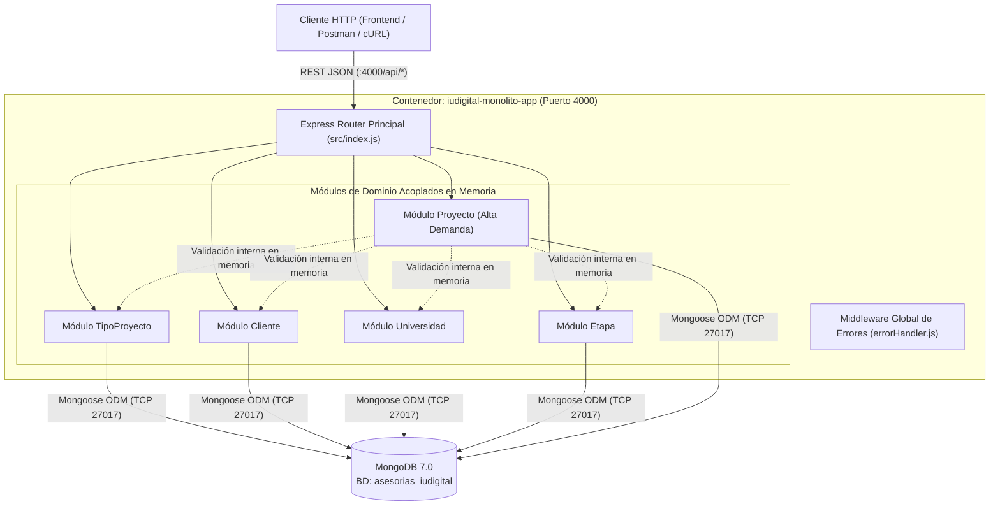
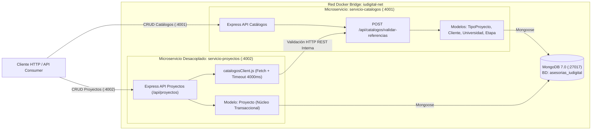
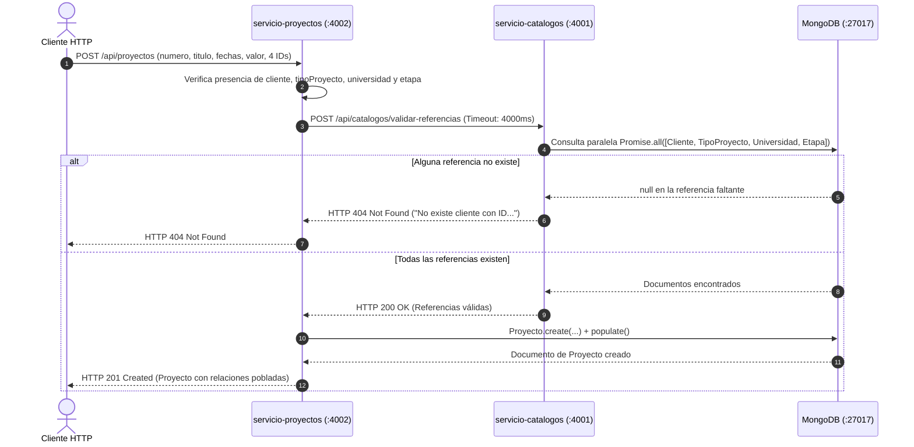
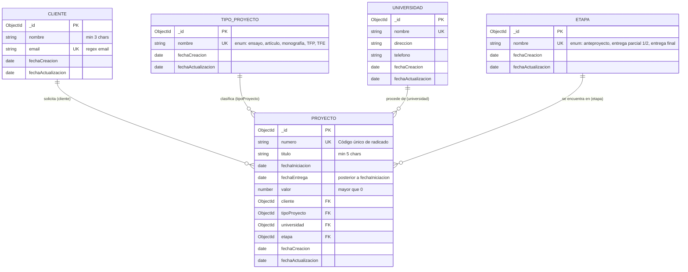

# 🏗️ 02. Arquitectura del Sistema (`02_ARQUITECTURA.md`)

Este documento presenta el diseño arquitectónico comparativo entre el **Sistema Monolítico Inicial** y la **Arquitectura Desacoplada basada en Microservicios**, así como el diseño de redes en Docker Compose y el modelo entidad-relación documental en MongoDB.

---

## 1. Arquitectura Monolítica Original (`backend-monolito`)

En la arquitectura monolítica, los 5 módulos de negocio comparten un único proceso de ejecución de Node.js (`puerto 4000`), un único pool de conexiones de Mongoose y un único ciclo de vida de despliegue.

### Limitaciones Operativas del Monolito
- **Escalabilidad todo-o-nada**: Si el módulo de `Proyectos` experimenta un pico de tráfico en cierres de semestre, es obligatorio replicar todo el monolito (incluyendo los catálogos estáticos).
- **Acoplamiento de disponibilidad**: Un pico de memoria o bloqueo en una consulta pesada de proyectos degrada también la administración de clientes y universidades.

---

## 2. Arquitectura Desacoplada en Microservicios (`backend-desacoplado`)

Para resolver el cuello de botella transaccional, el módulo **`Proyecto`** se extrae a un microservicio independiente (`servicio-proyectos` en el puerto `4002`), mientras que las entidades maestras permanecen en el microservicio de datos maestros (`servicio-catalogos` en el puerto `4001`).

---

## 3. Flujo de Secuencia: Creación de un Proyecto en Arquitectura Desacoplada

El siguiente diagrama detalla qué ocurre cuando un usuario registra una nueva asesoría en `POST http://localhost:4002/api/proyectos`:

---

## 4. Modelo Entidad-Relación Documental (MongoDB / Mongoose)

