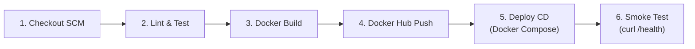

# 🚀 06. Configuración del Pipeline de Despliegue Continuo (CD) en Jenkins (`06_JENKINS_CD_PIPELINE.md`)

Este manual detalla paso a paso cómo levantar o configurar **Jenkins LTS**, registrar las credenciales seguras de **Docker Hub** (`dockerhub-credentials`), crear el Job Declarativo apuntando a [`jenkins/Jenkinsfile`](../jenkins/Jenkinsfile) y verificar el despliegue continuo (CD).

---

## 1. Requisitos del Servidor / Agente Jenkins

Para ejecutar el pipeline completo, el servidor donde corre Jenkins debe contar con:
1. **Git** instalado.
2. **Node.js (v18+ o v20+)** para la etapa de validación de sintaxis (`node --check`).
3. **Docker CLI y Docker Compose v2** con permisos sobre el socket `/var/run/docker.sock`.
4. **Plugins de Jenkins instalados**:
   - *Pipeline* (`workflow-aggregator`)
   - *Git Plugin* (`git`)
   - *Docker Pipeline* (`docker-workflow`)
   - *Credentials Binding Plugin* (`credentials-binding`)

### Cómo dar permisos de Docker al usuario `jenkins` (Linux / WSL)
```bash
sudo usermod -aG docker jenkins
sudo systemctl restart jenkins
```
*(Si usas el archivo [`jenkins/docker-compose-jenkins.yml`](../jenkins/docker-compose-jenkins.yml) incluido en este proyecto, el contenedor de Jenkins ya monta `/var/run/docker.sock` con los permisos listos).*

---

## 2. Configuración de Credenciales de Docker Hub en Jenkins UI

El `Jenkinsfile` utiliza el identificador de credenciales **`dockerhub-credentials`**. Para registrarlo en Jenkins:

1. Ingresa al panel de Jenkins en `http://localhost:8080`.
2. Ve a **Manage Jenkins** (Administrar Jenkins) → **Credentials** (Credenciales).
3. Haz clic en **System** → **Global credentials (unrestricted)** → botón **+ Add Credentials**.
4. Completa el formulario con los siguientes valores exactos:
   - **Kind (Tipo)**: `Username with password`
   - **Scope**: `Global (Jenkins, nodes, items, all child items, etc)`
   - **Username**: Tu nombre de usuario de Docker Hub (ej. `alejandroiudigital`).
   - **Password**: Tu contraseña o *Personal Access Token (PAT)* generado en Docker Hub (*Account Settings → Security → New Access Token*).
   - **ID**: **`dockerhub-credentials`** *(Obligatorio que coincida exactamente con este nombre)*.
   - **Description**: `Credenciales oficiales de Docker Hub para Pipeline CD IUDigital`.
5. Haz clic en **Create**.

---

## 3. Creación del Pipeline Job en Jenkins UI

1. En el panel principal de Jenkins (`Dashboard`), haz clic en **+ New Item** (Nueva Tarea).
2. En **Enter an item name**, escribe: **`IUDigital-Asesorias-CD-Pipeline`**.
3. Selecciona la opción **Pipeline** y presiona **OK**.
4. En la sección **General**:
   - Marca *"This project is parameterized"* (o deja que Jenkins lo cargue automáticamente en la primera ejecución del `Jenkinsfile`).
5. Baja hasta la sección **Pipeline**:
   - **Definition**: Selecciona **`Pipeline script from SCM`**.
   - **SCM**: Selecciona **`Git`**.
   - **Repository URL**: Ingresa la URL de tu repositorio Git (o la ruta local del repositorio).
   - **Branches to build**: `*/main` (o `*/master` según tu rama).
   - **Script Path**: Escribe exactamente:
     ```text
     jenkins/Jenkinsfile
     ```
6. Haz clic en **Save** (Guardar).

---

## 4. Explicación Detallada de las 6 Etapas del `Jenkinsfile`



| Etapa | Acción Automatizada | Comando / Bloque Clave |
|---|---|---|
| **1. Checkout SCM** | Descarga la última versión del código desde el repositorio Git. | `checkout scm` |
| **2. Lint & Test** | Verifica que todos los puntos de entrada de Node.js tengan sintaxis válida sin errores de compilación. | `node --check backend-monolito/src/index.js` (y microservicios) |
| **3. Build de Imágenes Docker** | Compila las imágenes Docker etiquetándolas con el número de build (`:${BUILD_NUMBER}`) y `:latest`. | `docker build -t ${IMAGE}:${IMAGE_TAG} -t ${IMAGE}:latest ...` |
| **4. Login y Publicación en Docker Hub** | Inyecta de forma segura `dockerhub-credentials`, inicia sesión con `--password-stdin` y ejecuta `docker push`. | `withCredentials([usernamePassword(credentialsId: 'dockerhub-credentials', ...)])` |
| **5. Continuous Deployment (CD)** | Invoca `scripts/deploy_cd.sh`, descarga las imágenes recién subidas y recrea los contenedores con `docker-compose.cd.yml`. | `bash scripts/deploy_cd.sh` |
| **6. Smoke Test** | Verifica mediante `curl -fsS` que los endpoints `/health` en los puertos `4000`, `4001` y `4002` respondan `HTTP 200 OK`. | `curl -fsS http://localhost:4001/health && curl -fsS http://localhost:4002/health` |

---

## 5. Ejecución y Verificación del Build en Jenkins

1. Entra al Job **`IUDigital-Asesorias-CD-Pipeline`**.
2. Haz clic en **Build with Parameters** (Construir con Parámetros):
   - **`ARQUITECTURA_DESPLIEGUE`**: Selecciona `ambas` (o `desacoplado` / `monolito`).
   - **`DOCKERHUB_NAMESPACE`**: Ingresa tu usuario de Docker Hub.
3. Presiona **Build**.
4. Observa en el **Stage View** cómo las 6 columnas se pintan de color verde y revisa en **Console Output** el mensaje final:
   `✅ [ÉXITO] Pipeline CD finalizado: Imágenes publicadas en Docker Hub y contenedores desplegados.`
